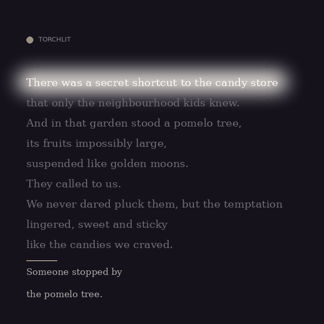

# TorchLit

A reading prototype. Readers light the sentences that stay with them while they read, at three intensities.
Other readers' lights appear only after a reader has finished, so each reading stays her own.

**Live demo:** https://linachoshha.github.io/torchlit/

## How it works

1. **Shelf:** a reader chooses a piece. The pieces are my own memoir writing.
2. **Reading:** the text is shown in pages. Tapping a sentence lights it; tapping again makes it brighter, up to
   three levels. Nothing about other readers' lights is shown during reading.
3. **Finish:** the reader sees her own lit lines.
4. **Community:** only after finishing, she can open the community view and replay how other readers moved through
   the piece.

Each tap is recorded with its order, the time since the previous tap, and how far the reader had read when she
lit it, so a later sentence can send her back to an earlier one.

## Status

Front-end prototype. The reading and reveal experience works, but readings are not saved yet: the database
integration is written but not connected, and the community view shows **demo readers**, not real reading data.

## Why it exists

TorchLit is the collection layer for Narrative Mirror. It is designed to gather voluntary, naturalistic,
sentence-level reader signals as a human reference for studying where language models lose the meaning that
readers hold. See [narrative-mirror-pilots](https://github.com/linachoshha/narrative-mirror-pilots).
